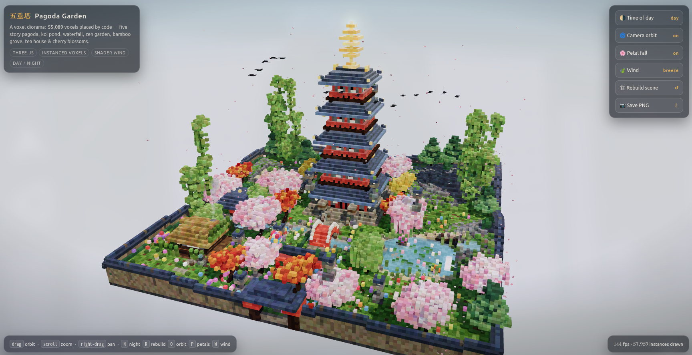

# Suzuku-Engine-q4

**Suzuku-Engine-q4**（略称: `q4`、旧名称: `SuzuQu-Engine-4exp`）は、
RDNA3 GPU（リファレンス環境は RX 7900 XTX 24GB）＋大容量 DRAM（リファレンスは 64GB）で
Qwen3.8-Flash-Next を極限まで最適化して動かすことを目的とした推論エンジンです。



OpenCode, xhighでPagoda Gardenを回した結果。Agenticな動作やCompactionの動作を検証するために、少しだけ修正を加えたFew-shotです。(one-shotのポン出しではありません)

- routed expert を DRAM に全常駐させ、よく使う expert だけを VRAM（L1）に置きます。PLE（n-gram 26.82 GiB）は SSD から読みます。
- MTP、vision入力、OpenAI 互換サーバー機能つき。
- 同じマシン・同じモデルで、decode は [Strata](https://github.com/Niko1221/Strata) (Niko1221様)の約 1.1〜1.5 倍、prefill は約 1.2 倍（下の「速度」）出ています。
- 試行錯誤の中で作った色んなコード(別量子化用のやつとか、SSDオフロード用のやつとか)もあります。ただし、この部分は古くなっている可能性があります。

設計の詳細と計測は [DESIGN.md](DESIGN.md)、gfx1100/ROCm 固有の知見と最適化ログは [ROCM-NOTES.md](ROCM-NOTES.md)、
最新の変更と計測の記録は [AGENTS.md](AGENTS.md) にあります。(古かったり人間のレビューを受けていなかったりするので、役に立つかはわかりません)

文中に出てくる一部の参照先（`MODEL-STRATEGY.md` / `QUANT-ESTIMATE.md` / `RDNA3-OPT.md` / `bench/` の一部）は未公開の作業メモです。

## 必要なもの

ハードウェアを限界ギリギリまで使う設定なので、下の条件を下回る環境では動かないか、とても遅くなります。

| | 必要 | リファレンス環境 |
| --- | --- | --- |
| GPU | RDNA3（gfx1100）、VRAM 24 GB | RX 7900 XTX |
| RAM | 64 GB（起動時に MemAvailable が 55 GiB 以上） | DDR5 64 GB |
| CPU | AVX2 / FMA / F16C 必須。AVX-512 VNNI（Zen 4 / 5）があると CPU 側の expert 計算が速い | Ryzen 9 9950X3D |
| ストレージ | NVMe 推奨。モデル 84 GB ＋ MTP 4 GB ＋ セッションキャッシュ（長い会話で最大 ~20 GB） | PCIe Gen4 NVMe |
| OS | Linux（systemd のユーザーセッション。メモリ上限の scope に使います） | CachyOS |
| ソフト | ROCm（hipcc、hipBLASLt）、gcc、make。セットアップに `hf`（`pip install -U huggingface_hub`）、python3 + numpy、curl、unzip。画像入力に cmake | ROCm 7.2.4、gcc 16 |

- Windows？なんすかWindowsって。（Linux 専用です）
- RX 7900 XTX以外でどう動くのかはよくわかりません

`scripts/check-env.sh` で、このマシンが条件を満たしているか、どこまで準備できているかを確認できます。

## クイックスタート

```sh
scripts/check-env.sh         # 環境チェック（何が足りないかを表示）
make                         # q4 と q4-test をビルド
./download_q4.sh             # モデル（GSQ-RCO IQ3_S、~84 GB）を models/GSQ-RCO/ に取得
scripts/setup-mtp.sh         # MTP（投機デコード）を準備。~8 GB をダウンロード、decode が約 1.8 倍
scripts/build-vision.sh      # （任意）画像入力用のエンコーダ q4-vision をビルド
./serve.sh                   # 127.0.0.1:8090 で待ち受け
```

起動は、expert（~44 GiB）を DRAM に常駐させるので 30 秒〜数分かかります（モデルがページキャッシュに載っていれば ~35 秒）。動作確認:

```sh
curl -s http://127.0.0.1:8090/v1/chat/completions \
  -H 'Content-Type: application/json' \
  -d '{"model":"qwen3.8-flash-next","messages":[{"role":"user","content":"1+1は?"}],"max_tokens":64}'
```

- `serve.sh` はブラウザや大きなダウンロードなど、RAM を大きく使うものを閉じてから起動してください。MemAvailable が 55 GiB 未満だと起動を断ります。
- q4 は 1 プロセスだけで動きます（2 つ目は起動を断ります）。
- モデルを別の場所に置いた場合は `Q4_MODEL=<1 つ目のシャード>` を指定します。MTP のファイルはモデルの隣に置かれます（`scripts/setup-mtp.sh <モデルのディレクトリ>`）。
- IQ3E-Q8D-MTP（pentacoxian 様作、1 ファイル）も使えます: `./download_q4.sh iq3e`。速度の表は GSQ-RCO IQ3_S で測ったものです。

### OpenCode から使う

`~/.config/opencode/opencode.jsonc` の `provider` に追加します（OpenCode 2.0.27 で確認）。

```jsonc
"q4": {
  "name": "q4",
  "npm": "@ai-sdk/openai-compatible",
  "options": { "baseURL": "http://127.0.0.1:8090/v1", "apiKey": "q4-local", "timeout": false },
  "models": {
    "qwen3.8-flash-next": {
      "name": "Qwen3.8 Flash-Next",
      "tool_call": true,
      "interleaved": "reasoning_content",
      "modalities": { "input": ["text", "image"], "output": ["text"] },
      "limit": { "context": 262144, "output": 262144 },
      "variants": {
        "none": { "reasoningEffort": "none" },
        "low": { "reasoningEffort": "low" },
        "medium": { "reasoningEffort": "medium" },
        "high": { "reasoningEffort": "high" },
        "xhigh": { "reasoningEffort": "xhigh" }
      }
    }
  }
}
```

- OpenCode は temperature / top_p を送らないので、サーバーの既定値（思考ありは temp 1.0 / top-k 20 / top-p 0.95、モデルカードの値）がそのまま使われます。
- `variants` の reasoningEffort が思考の強さになります（none で思考オフ）。
- 画像を送るには `modalities` が必要です（`"attachment": true` は OpenCode 2.x では無視されます）。
- 会話はセッションキャッシュ（`Q4_SESS_CACHE`、最大 4 会話）でターンをまたいで再利用されます。タイトル生成やサブエージェントのリクエストが挟まっても、メインの会話を最初から読み直しません。OpenCode の自動 compaction や、古い画像の削除の後も続きから読みます。

## serve.sh の既定

限界まで最適化した都合上、環境によっては書き換えが必要かもしれません。どの値も環境変数で上書きできます（下の「ノブ」）。

- モデルは `models/GSQ-RCO/IQ3_S/`（`download_q4.sh` の置き場所）、なければ `models/IQ3E-Q8D-MTP/`。リポジトリの隣の `../models/` も探します。`Q4_MODEL` で任意のパスを指定できます。
- expert はDRAMに全常駐（`Q4_EXPERT_RESIDENT=1`、`Q4_RES_BUDGET_GIB=47`、~44 GiB）です。GPU スロットの DRAM ミラーは作りません。
- KV は q8_0です。コンテキスト長は **262144**（学習長）です。q8 KV + GDN は 3.30 GiBになります。QSA は 2051 トークン幅の疎な Attention なので、伸ばしても prefill はそこまで落ちません。実用上の枠はハーネス側の compaction で調整することをおすすめします(このモデルは長考が多いため)。
- MTP（投機デコード）は、モデルの隣に `mtp-head.gguf` と `mtp-rt/` があればオン（`Q4_MTP_N=3`）になります。無ければ plain decode で、起動時にその旨を表示します。`Q4_MTP=0` でplain decodeを強制できます。
- 静的 L1 に置く expert の集合（ルーティングプロファイル）は、モデルの隣の `route-prof-*.warm`、無ければ `warm/` に同梱したものを使います。自分の用途で取り直すときは `Q4_ROUTE_PROF=<path>` で採取します（終了時に保存）。
- 待受は `127.0.0.1:8090`（OpenAI 互換 `/v1/chat/completions`）です。
- `systemd-run --user --scope -p MemoryMax=52G -p MemorySwapMax=0` の中で起動（`Q4_MEM_MAX`）します。上限を超えたときは q4 だけが落ち、デスクトップ等は生き残る…はずです(何度も落ちていたが、最近は落ちないので多分大丈夫)。1 秒ごとの watchdog が空き RAM / VRAM を見て、足りなくなる前に q4 を止めます（ログは `serve.mon`）。

## 画像入力（vision）

OpenAI 形式の `image_url`（`data:` URL の base64、またはローカルの絶対パス）と、Anthropic 形式の `image`（`source.base64`）を受け付けます。http(s) の URL は取りに行きません（400 を返します）。

```sh
./scripts/build-vision.sh          # q4-vision（CPU 版の画像エンコーダ）をビルド。llama.cpp を固定コミットで取得
./serve.sh                         # download_q4.sh が置いた mmproj を自動で使う（別の場所なら Q4_VISION_MMPROJ=<path>）
```

- エンコーダ（mmproj: 27 層の ViT ＋ projector、BF16 で 0.9 GB）は **CPU で動かし、重みと作業領域は DRAM に置きます**。エンコーダは VRAM を使わないので、expert の L1 は減りません（エンジン側は画像のある最初の要求で M-RoPE の位置表を確保します。プロンプト 1 セルあたり 12 B、ctx 全体でも 3 MiB 以下）。
- 別プロセス `q4-vision` で動きます（llama.cpp の mtmd を使用。Strata の `strata-vision` と同じプロトコルなので `Q4_VISION_BIN` でどちらも使えます）。最初の画像が来たときに起動して常駐します。常駐時の RSS は約 1.1 GiB で、q4 と同じ memory cgroup に入ります。起動時に MemAvailable が `Q4_VISION_NEED_GIB`（既定は watchdog の `Q4_SAFE_FLOOR` + 2 GiB = 5）未満なら起動を断ります。
- エンコード時間（9950X3D、16 スレッド、BF16、flash attention オフ = FP32 の attention）は次のとおりです。

  | 画像トークン | 例 | 時間 |
  | --- | --- | --- |
  | 300 | 640×488 の写真 | 0.84–0.87 s |
  | 475 | 800×600 | 1.7–1.9 s |
  | 972 | 1600×1220（上限 1024 で縮小） | 6.0–6.1 s |

  ViT はトークン 1 つあたり 4 パッチに attention を張るので、時間はトークン数より速く伸びます。上限は `Q4_VISION_MAX_TOKENS`（既定 1024）で下げられます。
- 同じ画像（バイト列が同じ）はエンコード結果を LRU（`Q4_VISION_CACHE_MIB`、既定 256）に保持します。チャットクライアントは毎ターン全画像を送り直しますが、エンコードは 1 回だけです。セッションキャッシュ（`Q4_SESS_CACHE`）も画像の中身で区別するので、同じサイズの別画像が同じ prefix と誤認されることはありません。
- 位置は M-RoPE（qwen4exp の interleaved 11/11/10）で、mtmd と同じ割り当てです。画像の後のテキストは `p + max(nx, ny)` から続きます。

## 速度（GSQ-RCO IQ3_S、Strata との比較）

コンテキスト長262144、思考オフ、temp 1 / top-k 20 / top-p 0.95、2 ラウンドの範囲（tok/s）で測定しました。
q4 は serve.sh の既定（MTP N=3）。tail skip は下の近似オプションで、ON の行は出力がわずかに変わります。
q4 の既定の行は 2026-10-15（NaN の修正後、d8f76c3）、ほかの行は 2026-10-14 の計測です。

| | 日本語 2.5K | エージェント 2.4K | コード | 8K 文書 | prefill 8K | prefill 32K |
| --- | ---: | ---: | ---: | ---: | ---: | ---: |
| q4（tail skip OFF、既定） | 84–89 | 65–70 | 69–96 ※2 | 91–93 | 1831–2150 | 2102–2306 |
| q4（tail skip ON、`Q4_TAIL_SKIP=7`） | 102–108 | 83–84 | 95–114 | 100–110 | 1920–2151 | 2250–2296 |
| Strata 0.1.43.1 最適化（tail skip OFF） | 57–58 | 56–71 | 61–65 | 63–68 | 1661–1750 | 1763–1779 |
| Strata 0.1.43.1 最適化（tail skip ON、`STRATA_ROUTE_TAIL_SKIP=7`） | 67–74 | 64–69 | 78–79 | 77 ※1 | 1736–1779 | 1758–1795 |

- 同じマシン（RX 7900 XTX、Ryzen 9 9950X3D、DDR5 64GB）、同じモデル、同じクライアントで1エンジンずつ計測しました。
  temp 1 の decode は受理率の揺れで回ごとに ±10% 程度ぶれます（Strata の tail skip OFF も、prefill 調整前の別の回では
  日本語 68–72、エージェント 61–71、コード 57–60、8K 文書 63–66）。
- Strata は手元で最適化した設定:
  `-DSTRATA_PREFILL_MMQ=ON` でビルド（既定の OFF だと prefill が約 3 割落ちました）、
  `STRATA_PF_FUSED=1 STRATA_PF_GEMM=1 STRATA_PF_SWITCH_MIN_T=4096`、`--prefill auto:32768`、`--pool-workers 12`、
  `--pcie-frac 0`、`--expert-cache 4200`、`--vram-reserve-mib 700`です。
  gfx1100 では tail skip は既定オフです（CUDA と RDNA4 では既定オン）。
- VRAM の空き（最小）: q4 約 3.2 GiB、Strata 約 3.0 GiBです。
- ※1 2 ラウンド目は 24 トークンで終わったため 1 ラウンド分
- ※2 2 ラウンド目のコードの 68.5 は 1 回だけの外れです（受理率は高く、1 サイクルが遅かった）。同じ日に別に取った
  6 ラウンド（既定のケース）では 日本語 83–93、エージェント 67–77、コード 91–102、prefill 8K 1767–2176、32K 2193–2321でした。

### 近似オプション: `Q4_TAIL_SKIP=7`

decode をもう一段速くしたいときの選択肢（既定はオフ）です。`Q4_TAIL_SKIP=7 ./serve.sh` で有効にできます。

- MTP の verify 窓（最大 4 トークン）で、「窓内のどのトークンでも 7 位以下（top-10 のうち重みの軽い 4 つ）にしか選ばれず、
  VRAM にも載っていない expert 」を、CPU で計算せずに省きます。省いた分は 0 として扱い、残りの重みは正規化し直しません。
  Strata の `STRATA_ROUTE_TAIL_SKIP` と同じ規則です。
- 効果: CPU に回る miss の約半分が消え、verify 1 回が 12–16% 短くなります（上の表の ON の行）。
- 代償: 出力が変わる近似です。ppl の平均はほぼ変わりません（3,000–5,000 トークンで ±0.002）が、
  トークン単位の予測は変わります（トップ 1 の入れ替わりが 3% → 8%、4 トークン窓で計測）。
- 数字は省く順位のしきい値です（top-10 なので意味があるのは 1–10。小さいほど多く省き、出力の変化も大きくなる）。計測したのは 7 だけです

## ノブ

| env | 既定 | 意味 |
| --- | --- | --- |
| `Q4_EXPERT_RESIDENT` | 1 | routed expert を tight pack で DRAM 常駐。0 で部分 L2 |
| `Q4_DRAM_RESERVE_GIB` | 4 | 常駐後に残す空き。 |
| `Q4_RES_BUDGET_GIB` | 47（serve.sh） | expert の DRAM 常駐イメージの上限。既定で全体（~44 GiB）を常駐させる。空にするとプランナーの控えめな予算（64 GB 機で ~40.5 GiB、残りは毎回 GGUF から読む）に戻る |
| `Q4_MEM_MAX` | 52G | systemd scope の MemoryMax。0 で cap なし |
| `Q4_L2_GIB` | 0 | 常駐が成功したときは無視。常駐できないときの DRAM L2 上限 |
| `Q4_MLOCK_L2` | 0 | 常駐イメージは mlock しない（rlimit 8 MB。成功してもマシンが固まる） |
| `Q4_KV` | q8 | `f16` / `f32` で広げる。セッションの幅が違うキャッシュは読めない |
| `Q4_CTX` | 262144 | 学習長。q8 KV + GDN 3.30 GiB |
| `Q4_VRAM_RESERVE_GIB` | 2 | 重みに使わない VRAM。1 未満は 1 になる。超えると画面が落ちるかも! |
| `Q4_L1_SLOTS` | MTP あり 3300 / なし 8192 | 要求の上限。VRAM 残量でこれより少なくなる（MTP ありは貸し借りで実際には ~4200 まで増える） |
| `Q4_IO_THREADS` | 8 | expert staging の I/O スレッド |
| `Q4_CPU_THREADS` | 12 | CPU エキスパートプール。16 でも同等だったので 12 で CCD を残した |
| `Q4_DEVROUTE` | 0 | デバイス側ルーティング。現状はホスト hybrid の方が ~11% 速い |
| `Q4_MISS_STAGE` | 1 | decode のミスを次トークン用に非同期ステージ。常駐時は 0 でもよい |
| `Q4_REPIN_EVERY` | 64 | decode N トークンごとに高ヒット expert を pin へ昇格 |
| `Q4_PIN_ARENA` | 0 | 部分 L2 の staging arena を hipHostRegister。常駐時は何もしない |
| `Q4_PIN_CAP` | (自動) | ピン数の上書き。未設定時は decode 1 ステップの 1.5 倍かつ L1 の 1/4 以下で、ヒット数が首位の 1/8 以上だけ |
| `Q4_WARM_FILE` | モデル横の `route-prof-*.warm`、無ければ `warm/` の同梱プロファイル | ピン集合（静的 L1 に置く expert）。モデルのバイト数・層数・expert 数が違うと捨てる |
| `Q4_ROUTE_PROF` | （未設定） | ルーティングヒットのヒストグラムを終了時に warm 形式で保存。そのまま `Q4_WARM_FILE` に指せば、部分 resident が層別カバレッジ均等化 quota で hot-set 充填される |
| `Q4_SESS_CACHE` | リポジトリ直下の `session.cache` | ターンをまたぐ prefix。同じプロンプトの再送は `session.cache.prompt` から再開する |
| `Q4_SESS_SLOTS` | 4 | セッションキャッシュに残す会話の数（`<path>.<k>`）。タイトル生成やサブエージェントのリクエストが来ても、メインの会話のスナップショットを上書きしない。1 で従来の単一ファイル |
| `Q4_THINK` | 1 | 0 で空の think ブロック（reasoning なし） |
| `Q4_SHOW_THINKING` | 1 | reasoning を `reasoning_content` に出す |
| `Q4_TEMP` / `Q4_TOP_K` / `Q4_TOP_P` / `Q4_PRESENCE` | 思考ありはモデルの `general.sampling`（Qwen3.8 は 1.0 / 20 / 0.95、presence 0）、思考なしはモデルカードの 0.7 / 20 / 0.8、presence 1.5 | リクエストがサンプリングを指定しないときの値。指定すると両モードに効く。OpenCode は temperature / top_p を送らないので、これがエージェントの実際の値になる |
| `Q4_DUMP_OUT` | （未設定） | ディレクトリを指すと、リクエストごとの本文 JSON、メッセージ、プロンプトの id 列、生成テキスト（思考・本文・tool call の XML そのまま）をファイルに書く |
| `Q4_DUMP_FIRST_LOGITS` | （未設定） | `<path>.<n>` に各リクエストのプロンプト末尾の logits を書く（Strata の `STRATA_DUMP_FIRST_LOGITS` と同じ形式。エンジン間の KL 比較用） |
| `Q4_TOOLS_COMPACT` | 0 | 1 で旧来の圧縮 tools 前置きに戻す（既定はチャットテンプレートどおりの tools ブロック） |
| `Q4_MAX_NEW` | コンテキスト長 | クライアントが `max_tokens` を省略したときの上限。残コンテキストでも切る |
| `Q4_KV_RECLAIM` | 1 | 長いリクエストの後に短いリクエストが来たら、KV に貸した expert スロットを取り戻す。0 で KV は伸びるだけ（再起動まで返さない） |
| `Q4_VMM_PIN` | 1 | 仮想アドレスごとに物理チャンクを固定する（貸し借りの後も同じチャンクに戻す）。0 は検証用の旧動作で、取り戻したスロットへのコピーが壊れることがある（AGENTS.md の NaN の項） |
| `Q4_TAIL_SKIP` | 0（オフ） | 近似オプション。verify 窓の全トークンが N 位以下に置いた VRAM 外の expert を省く（上の「近似オプション」）。7 で decode 約 +15%、出力は少し変わる |
| `Q4_MTP` | モデル横の `mtp-head.gguf` | ドラフトヘッドの GGUF のパス（`scripts/setup-mtp.sh` が用意する）。`0` でオフ。`Q4_MTP_N`（既定 3）、`Q4_MTP_RT`（Q2_0 の draft expert パック。既定はヘッド横の `mtp-rt/`、無ければ MTP はオフ）と組み合わせる。詳細は AGENTS.md |
| `Q4_VISION_MMPROJ` | モデル横（または 1 つ上）の `mmproj*.gguf` | 画像エンコーダ（mmproj）。`0` で画像オフ。未設定で見つからなければオフ |
| `Q4_VISION_MAX_TOKENS` | 1024 | 1 画像あたりの最大トークン数（`Q4_VISION_MIN_TOKENS` で下限）。CPU のエンコード時間はこれで決まる |
| `Q4_VISION_THREADS` | コア数 | エンコーダのスレッド数 |
| `Q4_VISION_BIN` | q4 の隣の `q4-vision` | エンコーダの実行ファイル（`strata-vision` も可） |
| `Q4_MAX_BODY_MIB` | 64 | リクエスト本文の上限（画像は base64 で本文に入る） |
| `Q4_BANNER` | 1 | 起動完了時の SUZUKU のロゴ。0 で出さない。端末でなければ色なし（`NO_COLOR` でも色なし） |
| `HIP_VISIBLE_DEVICES` | 0 | iGPU を隠す |

## モデル

GGUF は各配布元から取得します（`download_q4.sh` が取得します）。重みはこのリポジトリには含まれず、それぞれのライセンスに従います。

- GSQ-RCO IQ3_S と画像エンコーダ `mmproj-Qwen3.8-Flash-Next-BF16.gguf`（ISTA-DASLab 様）: <https://huggingface.co/ISTA-DASLab/Qwen3.8-Flash-Next-GSQ-RCO-GGUF>
- IQ3E-Q8D-MTP（pentacoxian 様）: <https://huggingface.co/pentacoxian-dev/Qwen3.8-Flash-Next-IQ3E-Q8D-MTP-GGUF>。MTP のドラフトヘッドは、このファイルの draft 層だけを HTTP の範囲指定で取り出して使います（`scripts/mtp-extract.py --hf`）。
- MTP の draft expert（Q2_0）: [Qwen/Qwen3.8-Flash-Next](https://huggingface.co/Qwen/Qwen3.8-Flash-Next) の BF16 チェックポイントから MTP のテンソルだけを取得し、Strata のツールで変換します（`scripts/setup-mtp.sh`）。

## 使わせていただいたもの

実装で参照・流用したものは次のとおりです（ライセンス表記は [THIRD_PARTY_NOTICES.md](THIRD_PARTY_NOTICES.md)）。詳細な比較メモや計測の生データはリポジトリには入れていません。

- [DwarfStar（ds4）](https://github.com/antirez/ds4)（MIT）。DeepSeek等をローカルで動かすための超人気エンジンです。q4 はこのエンジンの DRAM / SSD オフロードの設計を参考に、そのフォークとして始まりました(当初このPCのメモリに収まりそうな量子化モデルはないと思っていたため)。現在は RDNA3 / ROCm 向けにほぼ書き直しています。
- [Strata](https://github.com/Niko1221/Strata)（MIT、Niko1221）。大バズした、Qwen3.8-Flash-Next 向けのエンジンです。投機デコード、expert の静的配置、hipBLASLt の解の選び方（`src/q4_hgemm_tuning.hpp` は Strata から改変）、MMQ の呼び方などを参照しました。MTP のランタイムは Strata のツールで作ります。
- [llama.cpp](https://github.com/ggml-org/llama.cpp)（MIT、ggml）。説明不要の大定番・超有名エンジンです。GGUF と量子化形式に使用しており、MMQ カーネルのサブセットを `third_party/llama.cpp` に同梱しています。エンジン本体が実行時に llama.cpp を使うことはありません。画像エンコーダ `q4-vision` だけは llama.cpp の mtmd ライブラリをリンクします（`scripts/build-vision.sh` が固定コミットを取得）。

## Special Thanks

- antirez さんと DwarfStar（ds4）コミュニティの皆さん — このエンジンの出発点です。
- Niko1221 さんと Strata コミュニティの皆さん — このエンジンの開発を再開する「希望」を与えてくださり、またここまでの速度を出せたのは、StrataがMTP ランタイムと多くの設計の手本になってくれたからです。
- ggml / llama.cpp の皆さん — GGUF、量子化形式、MMQ カーネル、mtmdに使用しています。llama.cppがなければ、ローカルLLMはないと言っていいと思います。
- pentacoxian さん（IQ3E-Q8D-MTP）、ISTA-DASLab（GSQ-RCO 量子化と mmproj）、Qwen チーム（Qwen3.8-Flash-Next） — 当然ながら、モデルがなければ何もできません。
- 日本の「地元のLLM」界隈の皆さんや、海外のLocal LLM コミュニティの皆さん — 同志たちの支えがあってこそ、私は開発を続けていけます。

## ライセンス

MIT（[LICENSE](LICENSE)）です。同梱・改変したサードパーティのコードについては [THIRD_PARTY_NOTICES.md](THIRD_PARTY_NOTICES.md)をご確認ください。
